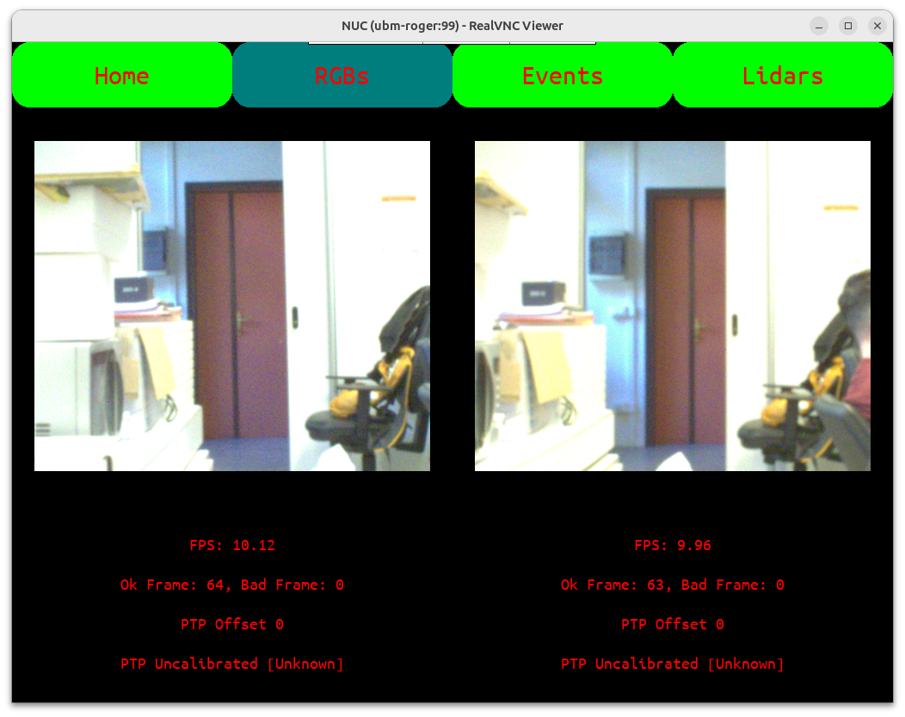

# CVLab Sensors

| Computers | ssh                      |
| --------  | -------                  |
| Orin      | `ssh cvlab@192.168.1.49` |
| Nuc       | `ssh ubm@192.168.1.50`   |

| Sensor Type | Sensor Name | SDK | Connection | IP | Instructions |
| --------    | -------     | -------   | ------- | ------- | ------- |
| Lidar  | OT128  | [HesaiLidar SDK](https://github.com/HesaiTechnology/HesaiLidar_SDK_2.0) | Ethernet | 192.168.1.90 |[Hesai Lidar](#hesai_lidar)|
| Lidar  | XT32  | [HesaiLidar SDK](https://github.com/HesaiTechnology/HesaiLidar_SDK_2.0) | Ethernet | 192.168.1.91 |[Hesai Lidar](#hesai_lidar)|
| Lidar  | Livox Hap  | [Livox SDK](https://github.com/Livox-SDK/Livox-SDK) | Ethernet | 192.168.1.100 | [Livox Lidar](#livox_lidar) |
| Lidar  | Livox Mid360  | [Livox SDK](https://github.com/Livox-SDK/Livox-SDK)  | Ethernet | 192.168.1.151 | [Livox Lidar](#livox_lidar)|
| Event Camera  | EVKV4 - HD | [Premium SDK](https://propheseeai.jfrog.io/ui/repos/tree/General/metavision-sdk-5-debian) | USB | | [Prophesee Event](#prophesee_event) |
| Depth Camera  | RealSense | [RealSense SDK]() | USB | | [RealSense](#realsense)|
| RGB Camera | Basler | [PyPylon](https://github.com/basler/pypylon/tree/master) | Ethernet |192.168.1.70-77 | [Basler](#basler) |

## Visualizer



## Time synchronization (PTP)
Every Ethernet sensor sits on its own USB network adapter (r8152), which has no
hardware timestamping. A single `ptp4l` with software timestamping serves the
NUC system clock to the Basler cameras and the Livox (accuracy: tens of microseconds):
```
sudo ptp4l -f get_data/config/ptp4l.conf -m
```
or install it as a service (starts at boot):
```
sudo cp get_data/config/ptp4l-cvlab.service /etc/systemd/system/
sudo systemctl daemon-reload && sudo systemctl enable --now ptp4l-cvlab
journalctl -u ptp4l-cvlab -f
```
- **Basler**: the RGB recorder refuses to record until both cameras are PTP `Slave` + `Locked`
  (use `--allow-unsynced` to record anyway). Frames are triggered by the PTP clock
  (`RGB_PTP_TRIGGER`), so left and right expose at the same instant (measured: < 0.2 ms apart).
- **Livox HAP**: needs PTP over L2 (set in `ptp4l.conf`); each H5 file stores `time_source` (`livox_ptp` when synced).
- Check everything with `get_data/check_ptp.py`.
- **Hesai XT32**: keep its clock source on GPS (free running). It cannot follow a two-step PTP
  master (software timestamping is always two-step): its clock jumps by seconds. Its H5 files
  store `sync` pairs, and `cvlab.lidar.LidarChunk.host_timestamps_ns()` maps it to host time.
- **Event cameras** (USB) are not on PTP: their clock is mapped to the host clock through the
  `*.sync.csv` file written next to each recording. For exact RGB-event sync, wire a Basler output
  line (LineSource = ExposureActive) into the EVK4 trigger input and set `EVENT_TRIGGER_IN = True`
  in `cvlab/config.py`.

## Recording
All settings (IPs, serials, exposure, paths, ...) are in `cvlab/config.py`.
- Terminal: `venv_3_12/bin/python get_data/get_data.py` (Ctrl+C to stop; `--only rgb event` to record a subset)
- Web dashboard: `Cameras_Server/start_server.sh`, then http://<NUC_IP>:5000

Sessions are recorded in `get_data/data/<date>/` and moved to `CVLab_live_imgs/<date>/` when saved.
Recording stops automatically when less than `MIN_FREE_DISK_GB` is free.
```
<session>/
├── rgb_left/, rgb_right/        <host_time_us>.png
├── event_left/, event_right/    <start_us>.raw (+ .sync.csv clock mapping, .json metadata)
├── lidar_livox/, lidar_hesai/   <host_time_us>.h5: xyz (mm, float32, native sensor frame),
│                                timestamp_ns (lidar clock), intensity, sync [lidar_ns, host_ns]
├── rgb_clock_sync.csv           Basler clock <-> host clock
├── logs/, status/, previews/
```
Readers for all of these are in `cvlab/` (`lidar.py`, `events.py`).

**Event cameras must be on USB3** (they are currently on a USB2 hub at 480 Mbps): a single
camera can produce more than USB2 can carry. Hot pixels are masked in hardware
(`EVENT_HOT_PIXELS` in `cvlab/config.py`, find them with `get_data/find_hot_pixels.py`).

## RGB-Event calibration
1. Record the chessboard (29 mm squares), moving it around: `get_data/get_data.py --only rgb event`
2. `RGB_Event_Calibration/process_calibration_data.py [session]`
3. `RGB_Event_Calibration/calibrate.py` (installs `CVLab_live_imgs/rgb_event_calibration.npz`)
4. Check: `CVLab_live_imgs/rectification.py {rgb,event}`, `CVLab_live_imgs/all_images_rect.py`

RGB images are center-cropped to 16:9 and resized to 1280x720 before calibration
(`cvlab.calibration.to_calibration_size`): do the same before using the intrinsics.

## Hesai Lidars
<a name="hesai_lidar"></a>
## Livox Lidars
<a name="livox_lidar"></a>
### Build
#### SDK Installation
From `/home/cvlab/CVLab_Sensors`
```
git clone https://github.com/Livox-SDK/Livox-SDK2.git
```
```
cd ./Livox-SDK2/
```
```
mkdir build
```
```
cd build
```
```
cmake .. && make -j
```
```
sudo make install
```
Documentation about lidar packets [here](https://github.com/Livox-SDK/Livox-SDK2/wiki/Livox-SDK-Communication-Protocol-HAP(English)#2-point-cloud--imu-data-protocol).
## RealSensor
<a name="realsense"></a>
### Build
#### SDK Installation
```
sudo apt-key adv --keyserver keyserver.ubuntu.com --recv-key F6E65AC044F831AC80A06380C8B3A55A6F3EFCDE || sudo apt-key adv --keyserver hkp://keyserver.ubuntu.com:80 --recv-key F6E65AC044F831AC80A06380C8B3A55A6F3EFCDE
sudo add-apt-repository "deb https://librealsense.intel.com/Debian/apt-repo $(lsb_release -cs) main" -u
sudo apt-get install librealsense2-utils
sudo apt-get install librealsense2-dev
```
You can try the correct installation with: `realsense-viewer`
## Event Camera
<a name="prophesee_event"></a>
### Programs and Documentation
- [SDK 5.0 deb](https://propheseeai.jfrog.io/ui/repos/tree/General/metavision-sdk-5-debian)
- [Metavision Studio](https://propheseeai.jfrog.io/ui/packages/deb:%2F%2Fmetavision-studio)
- [Creating a Python Venv](https://docs.prophesee.ai/stable/installation/linux.html#installing-dependencies)
- I have linked some Python scripts in `/home/ubm/CVLab_Sensors/EventCamerasWorkingArea/samples`
### Calibration
```
metavision_calibration_pipeline
```
Blinking chessboard at: `/usr/share/metavision/sdk/calibration/cpp_samples/metavision_calibration_pipeline/metavision_calibration_pattern_chessboard.html`
## RGB Camera
<a name="basler"></a>
Change the IP using:
```
/opt/pylon/bin/ipconfigurator
```
Change camera settings using:
```
/opt/pylon/bin/pylonviewer
```
