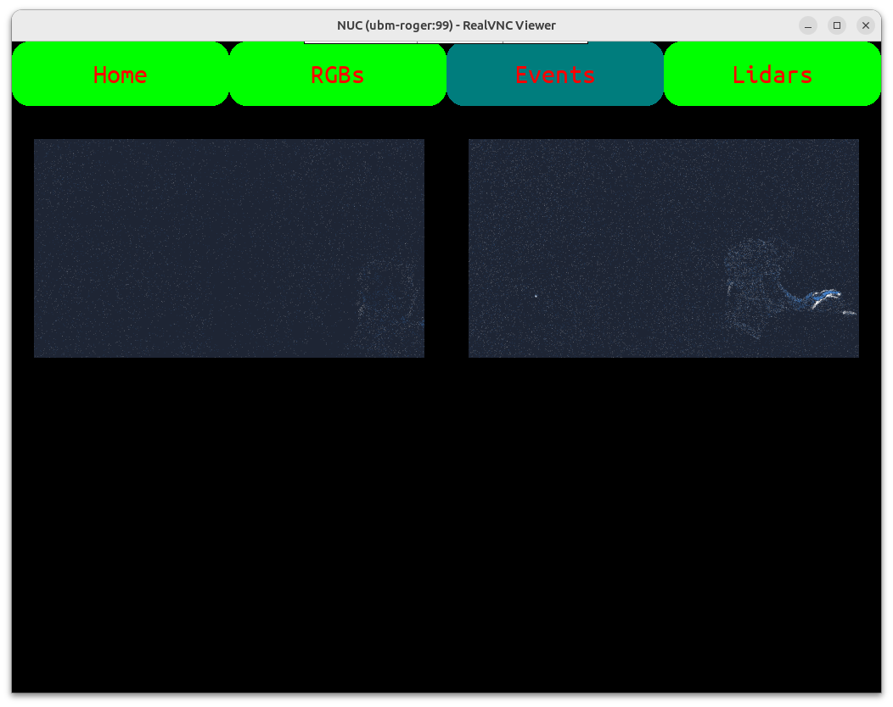

# CVLab Sensors

| Computers | ssh                    | Password |
| --------  | -------                | -------   |
| Orin      | `ssh cvlab@192.168.1.49` | cvlabsensors |
| Nuc       | `ssh ubm@192.168.1.50`   | ubm12345 |

| Sensor Type | Sensor Name | SDK | Connection | IP | Instructions |
| --------    | -------     | -------   | ------- | ------- | ------- |
| Lidar  | OT128  | [HesaiLidar SDK](https://github.com/HesaiTechnology/HesaiLidar_SDK_2.0) | Ethernet | 192.168.1.90 |[Hesai Lidar](#hesai_lidar)|
| Lidar  | XT32  | [HesaiLidar SDK](https://github.com/HesaiTechnology/HesaiLidar_SDK_2.0) | Ethernet | 192.168.1.91 |[Hesai Lidar](#hesai_lidar)|
| Lidar  | Livox Hap  | [Livox SDK](https://github.com/Livox-SDK/Livox-SDK) | Ethernet | 192.168.1.100 | [Livox Lidar](#livox_lidar) |
| Lidar  | Livox Mid360  | [Livox SDK](https://github.com/Livox-SDK/Livox-SDK)  | Ethernet | 192.168.1.151 | [Livox Lidar](#livox_lidar)|
| Event Camera  | EVKV4 - HD | [Premium SDK](https://propheseeai.jfrog.io/ui/repos/tree/General/metavision-sdk-5-debian) | USB | | [Prophesee Event](#prophesee_event) |
| Depth Camera  | RealSense | [RealSense SDK]() | USB | | [RealSense](#realsense)|
| RGB Camera | Basler | [PyPylon](https://github.com/basler/pypylon/tree/master) | Ethernet |192.168.1.70-77 | [Basler](#basler) |

## Visualizer



## Starting PTP Server on NUC
```
sudo ptp4l -i enp2s0 -m --step_threshold=1
```
If needed you can set the time with a 2-hour (7200 seconds) delay because of the Italian timezone:
```
sudo phc2sys -s CLOCK_REALTIME -c enp2s0 -m -O 0
```
## Hesai Lidars
<a name="hesai_lidar"></a>
## Livox Lidars
<a name="livox_lidar"></a>
### Build
#### SDK Installation
From `/home/cvlab/CVLab_Sensors`
```
git clone https://github.com/Livox-SDK/Livox-SDK2.git
```
```
cd ./Livox-SDK2/
```
```
mkdir build
```
```
cd build
```
```
cmake .. && make -j
```
```
sudo make install
```
Documentation about lidar packets [here](https://github.com/Livox-SDK/Livox-SDK2/wiki/Livox-SDK-Communication-Protocol-HAP(English)#2-point-cloud--imu-data-protocol).
## RealSensor
<a name="realsense"></a>
### Build
#### SDK Installation
```
sudo apt-key adv --keyserver keyserver.ubuntu.com --recv-key F6E65AC044F831AC80A06380C8B3A55A6F3EFCDE || sudo apt-key adv --keyserver hkp://keyserver.ubuntu.com:80 --recv-key F6E65AC044F831AC80A06380C8B3A55A6F3EFCDE
sudo add-apt-repository "deb https://librealsense.intel.com/Debian/apt-repo $(lsb_release -cs) main" -u
sudo apt-get install librealsense2-utils
sudo apt-get install librealsense2-dev
```
You can try the correct installation with: `realsense-viewer`
## Event Camera
<a name="prophesee_event"></a>
### Programs and Documentation
- [SDK 5.0 deb](https://propheseeai.jfrog.io/ui/repos/tree/General/metavision-sdk-5-debian)
- [Metavision Studio](https://propheseeai.jfrog.io/ui/packages/deb:%2F%2Fmetavision-studio)
- [Creating a Python Venv](https://docs.prophesee.ai/stable/installation/linux.html#installing-dependencies)
- I have linked some Python scripts in `/home/ubm/CVLab_Sensors/EventCamerasWorkingArea/samples`
### Calibration
```
metavision_calibration_pipeline
```
Blinking chessboard at: `/usr/share/metavision/sdk/calibration/cpp_samples/metavision_calibration_pipeline/metavision_calibration_pattern_chessboard.html`
## RGB Camera
<a name="basler"></a>
Change the IP using:
```
/opt/pylon/bin/ipconfigurator
```
Change camera settings using:
```
/opt/pylon/bin/pylonviewer
```
